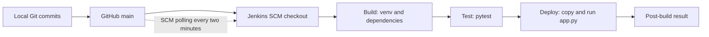

# Lab 1 - DevOps Foundations & Continuous Integration

**Course:** DevOps and Automation Lab (ENSP461)  
**Student:** Aditya Porwal | **GitHub:** `Adityaporwal18`  
**Application:** a small Python calculator (`add`, `subtract`) with a Jenkins build, test and deploy pipeline.

## Workflow



## Pipeline stages

The pipeline is defined in [Jenkinsfile](Jenkinsfile) (declarative syntax).

| Stage | What it does |
|---|---|
| Build | Creates a Python virtual environment, installs `requirements.txt` and compiles `app.py` |
| Test | Runs `pytest -v` (4 unit tests in `test_app.py`) |
| Deploy | Copies `app.py` into a `deploy/` folder in the Jenkins workspace and runs it as a smoke test |

- **Trigger:** `pollSCM('H/2 * * * *')` - Jenkins checks GitHub about every two minutes and starts a build when `main` has a new commit.
- **Post-build actions:** a success or failure message is printed by the `post` block.

The Deploy stage stages and runs a command-line application inside the Jenkins workspace. It does not publish a website or deploy to a remote server.

## Run the application locally

In an Ubuntu terminal with Python 3 and `python3-venv` installed:

```bash
git clone https://github.com/Adityaporwal18/devops-lab1.git
cd devops-lab1
python3 -m venv venv
source venv/bin/activate
pip install -r requirements.txt
python3 app.py
pytest -v
```

Expected output of `python3 app.py`:

```text
DevOps Lab 1 Application
2 + 3 = 5
5 - 3 = 2
```

## Main files

```text
app.py                 Sample command-line application (add, subtract)
test_app.py            Four pytest unit tests
requirements.txt       Test dependency (pytest)
Jenkinsfile            Declarative Build -> Test -> Deploy pipeline
README.md              Project overview
REPORT.md              Lab report
commands.txt           Commands used in the lab
docs/                  Lab task sheet and evidence
```
