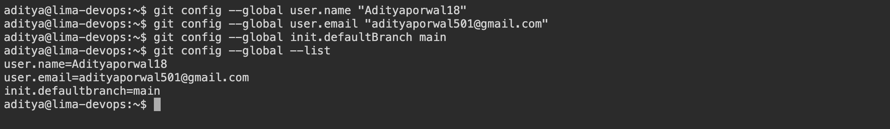
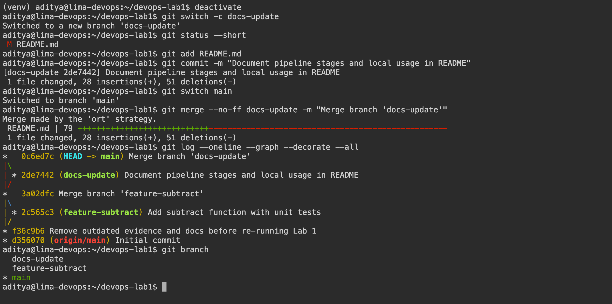
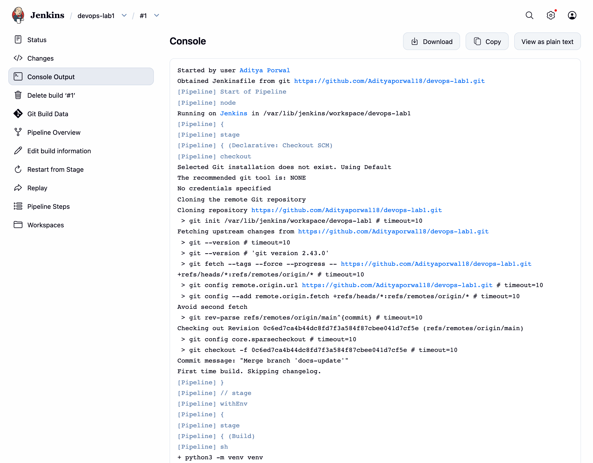
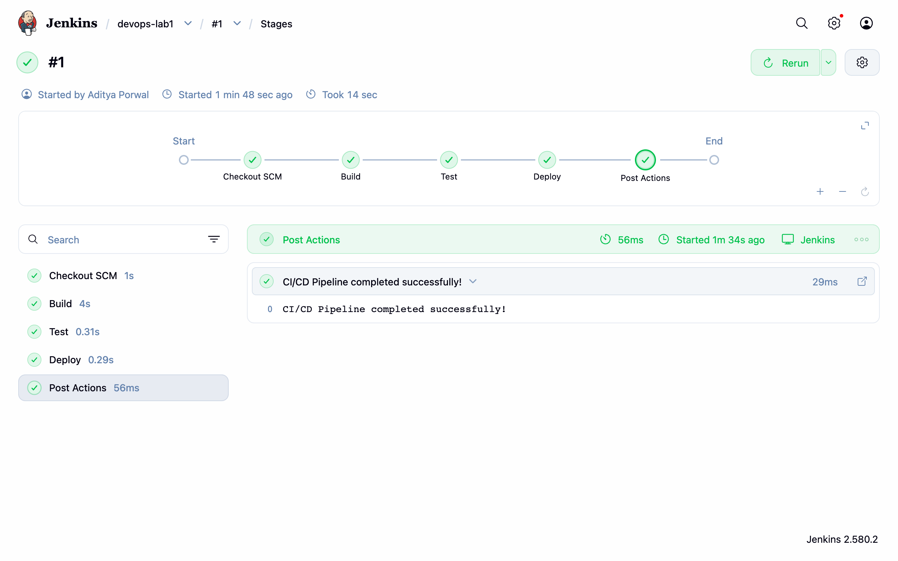
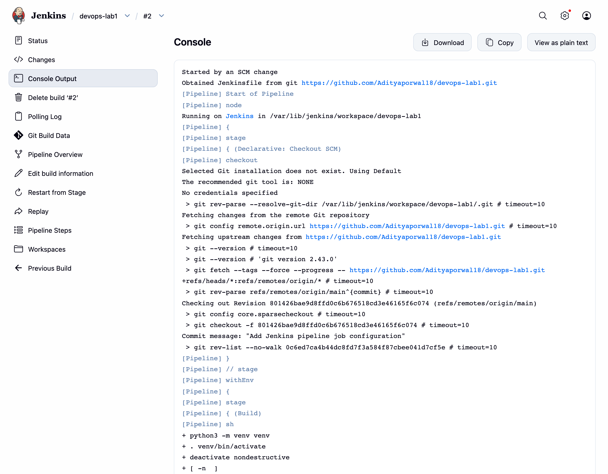
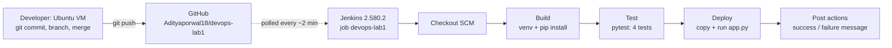
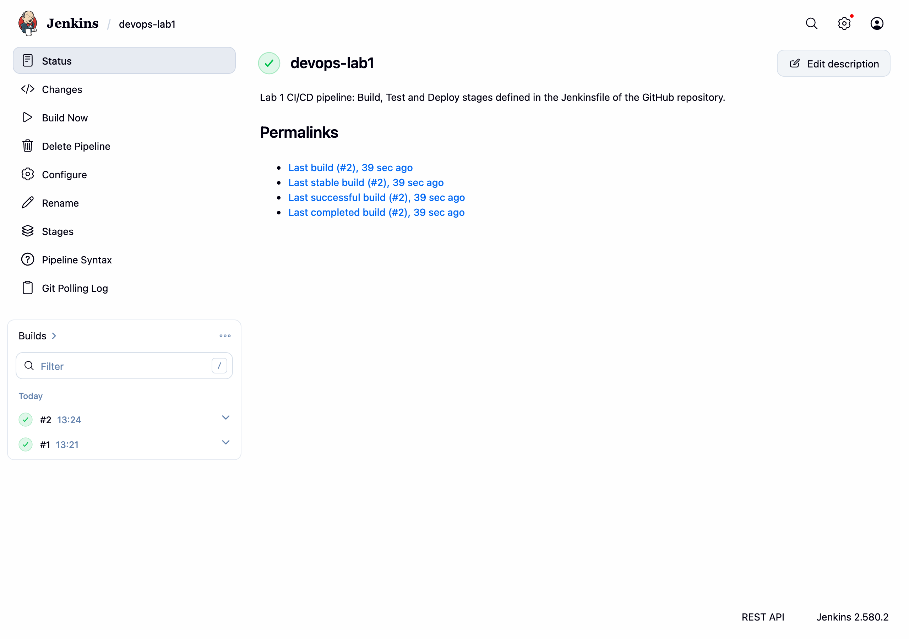

# Lab 1 Report - DevOps Foundations & Continuous Integration

**Course:** DevOps and Automation Lab (ENSP461)  
**Student:** Aditya Porwal  
**Repository:** https://github.com/Adityaporwal18/devops-lab1  
**Environment:** Ubuntu 24.04.5 LTS virtual machine (Lima 2.3.0) on a MacBook Pro (Apple M1, macOS 26.4)  
**Date of this run:** 25 November 2026  
**Application language:** Python | **Pipeline syntax:** Declarative Jenkins Pipeline

[Repository overview](README.md) | [Evidence gallery](docs/EVIDENCE.md) | [Commands executed](commands.txt)

## 1. Aim

To build a foundational DevOps workflow for a sample application: Git-based version control, a GitHub repository, a Jenkins CI/CD pipeline with build, test and deploy stages, and an automated trigger that starts the pipeline when new code is pushed.

## 2. Environment and tools

The lab was run in an Ubuntu virtual machine. All versions below are the ones observed during this run.

| Component | Observed value | Evidence |
|---|---|---|
| Operating system | Ubuntu 24.04.5 LTS (noble), kernel 6.8.0-147-generic, aarch64 | [E01](docs/evidence/screenshots/01-ubuntu-version.png) |
| Git | 2.43.0 | [E02](docs/evidence/screenshots/02-git-install-and-version.png) |
| Java | OpenJDK 21.0.13.1 | [E03](docs/evidence/screenshots/03-java-install-and-version.png) |
| Init system | systemd, state `running` | [E04](docs/evidence/screenshots/04-systemd-running.png) |
| Jenkins | 2.580.2 (LTS), systemd service enabled and active | [E06](docs/evidence/screenshots/06-jenkins-install-and-version.png), [E07](docs/evidence/screenshots/07-jenkins-service.png) |
| Python / pytest | Python 3.12.3, pytest 9.2.0 | [E17](docs/evidence/screenshots/17-local-tests-pass.png) |
| GitHub CLI | gh 2.45.0 | [E21](docs/evidence/screenshots/21-install-github-cli.png) |
| GitHub | Public repository `Adityaporwal18/devops-lab1`, branch `main` | [E24](docs/evidence/screenshots/24-github-repository.png) |

## Q1 - Install and configure Git and Jenkins

**Procedure.** Packages were installed with `apt`. Jenkins was installed from the official `debian-stable` apt repository after adding its signing key, and runs as a systemd service. The Jenkins setup wizard was completed in the browser: unlock with the initial admin password, install the suggested plugins, create the first admin user. Finally the global Git identity was configured.

```bash
sudo apt update
sudo apt install git -y
sudo apt install fontconfig openjdk-21-jre python3-venv -y
sudo wget -q -O /etc/apt/keyrings/jenkins-keyring.asc https://pkg.jenkins.io/debian-stable/jenkins.io-2026.key
echo "deb [signed-by=/etc/apt/keyrings/jenkins-keyring.asc] https://pkg.jenkins.io/debian-stable binary/" | sudo tee /etc/apt/sources.list.d/jenkins.list > /dev/null
sudo apt update
sudo apt install jenkins -y
sudo systemctl enable --now jenkins
git config --global user.name "Adityaporwal18"
git config --global user.email "adityaporwal501@gmail.com"
git config --global init.defaultBranch main
```

**Result.** Git 2.43.0, OpenJDK 21 and Jenkins 2.580.2 are installed. The Jenkins service is enabled and active, the wizard installed 92 plugins, and the dashboard is available at `http://localhost:8080` for the user **Aditya Porwal**. `git config --global --list` shows the configured name and email.



Evidence: [E01-E13](docs/EVIDENCE.md#q1---install-and-configure-git-and-jenkins)

## Q2 - Set up version control using Git

**Application.** `app.py` is a small command-line calculator with `add()` and `subtract()`. `test_app.py` contains four pytest unit tests.

**Procedure.** The GitHub repository already existed (commit `d356070`, 13 November 2026). For this run a new local repository was initialised in the VM with `git init`, connected to GitHub with `git remote add` and synchronised with `git pull origin main`. The earlier evidence files were removed in the first commit, and the work was then done on branches:

1. `feature-subtract` - adds `subtract()` and two tests; tests run locally (4 passed); committed and merged into `main` with `--no-ff`.
2. `docs-update` - rewrites the README; committed and merged into `main` with `--no-ff`.
3. Authentication with `gh auth login`, then `git push -u origin main`.

**Commit history of this run** (before the documentation commits):

| Commit | Branch | Message |
|---|---|---|
| `f36c9b6` | main | Remove outdated evidence and docs before re-running Lab 1 |
| `2c565c3` | feature-subtract | Add subtract function with unit tests |
| `3a02dfc` | main | Merge branch 'feature-subtract' |
| `2de7442` | docs-update | Document pipeline stages and local usage in README |
| `0c6ed7c` | main | Merge branch 'docs-update' |
| `801426b` | main | Add Jenkins pipeline job configuration |



**Result.** Initialising, staging, committing, branching, merging and pushing were all carried out. The push updated GitHub from `d356070` to `0c6ed7c`, and GitHub shows the commits under the account `Adityaporwal18`.

Evidence: [E14-E26](docs/EVIDENCE.md#q2---version-control-with-git-and-github)

## Q3 - Implement a basic Jenkins CI/CD pipeline

**Configuration.** A Pipeline job named `devops-lab1` reads its pipeline from the GitHub repository. The job definition is stored in the repository as [jenkins/job-config.xml](jenkins/job-config.xml) and was created through the Jenkins REST API.

| Setting | Value |
|---|---|
| Job type | Pipeline |
| Definition | Pipeline script from SCM |
| SCM | Git |
| Repository URL | `https://github.com/Adityaporwal18/devops-lab1.git` |
| Branch | `*/main` |
| Script path | `Jenkinsfile` |

**Result.** Build #1 was started manually by the user Aditya Porwal. Jenkins obtained the Jenkinsfile from GitHub, cloned the repository, checked out revision `0c6ed7c` and finished with **SUCCESS** in 14.7 seconds.



Evidence: [E27-E31](docs/EVIDENCE.md#q3-q5---jenkins-pipeline-stages-and-automated-trigger)

## Q4 - Create a Jenkinsfile defining pipeline stages

The [Jenkinsfile](Jenkinsfile) uses declarative syntax with three stages.

| Stage | Commands | Result in build #1 |
|---|---|---|
| Build | `python3 -m venv venv`, `pip install -r requirements.txt`, `python3 -m compileall app.py` | Dependencies installed (pytest 9.2.0), `app.py` compiled |
| Test | `pytest -v` | 4 passed |
| Deploy | `mkdir -p deploy`, `cp app.py deploy/app.py`, `python3 deploy/app.py` | Application copied and executed |

Console output of the Deploy stage and the end of build #1 (from the [full log](docs/evidence/logs/jenkins-build-1-console.txt)):

```text
+ mkdir -p deploy
+ cp app.py deploy/app.py
+ python3 deploy/app.py
DevOps Lab 1 Application
2 + 3 = 5
5 - 3 = 2
...
CI/CD Pipeline completed successfully!
...
Finished: SUCCESS
```



## Q5 - Automate application deployment

**Build trigger.** The Jenkinsfile declares `pollSCM('H/2 * * * *')`. After the first build Jenkins registered the trigger and now polls GitHub about every two minutes.

**Demonstration.** A new commit was pushed and no build was started manually:

| Time (IST) | Event | Evidence |
|---|---|---|
| 13:23:21 | Commit `801426b` pushed to GitHub | [E32](docs/evidence/screenshots/32-push-change-for-scm-trigger.png) |
| 13:24:00 | Polling compares `0c6ed7c` with remote head `801426b`: **Changes found** | [E35](docs/evidence/screenshots/35-jenkins-scm-polling-log.png) |
| 13:24:08 | Build #2 begins: **Started by an SCM change** | [E33](docs/evidence/screenshots/33-jenkins-build-2-started-by-scm-change.png) |
| 13:24:14 | Build #2 ends: 4 passed, application deployed, **SUCCESS** (5.8 s) | [E34](docs/evidence/screenshots/34-jenkins-build-2-console-end.png) |



**Post-build actions.** The `post` block prints `CI/CD Pipeline completed successfully!` on success and `Pipeline failed.` on failure. Both builds show the success message.

**Deployment steps and scope.** The Deploy stage copies `app.py` into a `deploy/` folder inside the Jenkins workspace and runs it as a smoke test. This is a local, command-line deployment. It does not publish a service or deploy to a remote server.

## Q6 - Record commands, configurations, screenshots and observations

| Record | Location |
|---|---|
| Commands, in the order they were run | [commands.txt](commands.txt) (extracted from the terminal logs) |
| Pipeline configuration | [Jenkinsfile](Jenkinsfile), [jenkins/job-config.xml](jenkins/job-config.xml) |
| Screenshots with captions | [docs/EVIDENCE.md](docs/EVIDENCE.md) |
| Terminal logs, Jenkins console logs, polling log | [docs/evidence/logs](docs/evidence/logs) |
| Commit history | Table in Q2, [GitHub commits](https://github.com/Adityaporwal18/devops-lab1/commits/main) |

**Observations.**

- Ubuntu's image already contained Git, so `apt install git` upgraded it instead of installing it for the first time.
- Jenkins needs Java before it can start. OpenJDK 21 was installed first, as the Jenkins documentation requires.
- The `pollSCM` trigger written in the Jenkinsfile only becomes active after the first build has run once.
- With `H/2 * * * *` the delay between a push and the automatic build was under one minute in this run (push 13:23:21, build 13:24:08). In general it can be up to about two minutes.
- Build #1 took 14.7 s because the virtual environment was created and pytest was downloaded. Build #2 reused the workspace and took 5.8 s.
- `requirements.txt` does not pin the pytest version, so a later build may install a newer pytest.

## Q7 - CI/CD workflow report

### Architecture



### Stages and timings (build #1)

| Stage | Duration | Outcome |
|---|---|---|
| Checkout SCM | 1 s | Repository cloned, revision `0c6ed7c` |
| Build | 4 s | venv created, pytest installed, `app.py` compiled |
| Test | 0.31 s | 4 passed |
| Deploy | 0.29 s | Application copied and executed |
| Post Actions | 56 ms | Success message printed |

### Automation results

| Build | Started | Cause | Revision | Result | Duration |
|---|---|---|---|---|---|
| #1 | 25 Nov 2026 13:21:18 | Started by user Aditya Porwal | `0c6ed7c` | SUCCESS | 14.7 s |
| #2 | 25 Nov 2026 13:24:08 | Started by an SCM change | `801426b` | SUCCESS | 5.8 s |



## Conclusion

The lab produced a working CI/CD workflow: code is versioned with Git using branches and merges, published to GitHub, and built, tested and deployed by a declarative Jenkins pipeline. A manual build and an automatically triggered build both succeeded, and the polling log confirms that the second build was started by the pushed commit. The deployment is a local smoke test inside the Jenkins workspace; deploying to a real server would be the next step.
