# Lab 1 Evidence - DevOps Foundations & Continuous Integration

All evidence on this page was captured on **25 November 2026** while running Lab 1 in an **Ubuntu 24.04.5 LTS virtual machine** (Lima 2.3.0 on a MacBook Pro with Apple M1, macOS 26.4).

**How it was captured.** Terminal screenshots show the VM's shell session through a browser-based terminal (ttyd attached to tmux). Web screenshots (Jenkins at `http://localhost:8080` and GitHub) were taken with headless Google Chrome. The capture is automated. Terminal screenshots are cropped below the last line of output; nothing else is edited. Every terminal screenshot has a text log with the complete output under [evidence/logs](evidence/logs).

[Project overview](../README.md) | [Lab report](../REPORT.md) | [Commands](../commands.txt)

| Section | Evidence |
|---|---|
| [Q1 - Install and configure Git and Jenkins](#q1---install-and-configure-git-and-jenkins) | E01-E13 |
| [Q2 - Version control with Git and GitHub](#q2---version-control-with-git-and-github) | E14-E26 |
| [Q3-Q5 - Jenkins pipeline, stages and automated trigger](#q3-q5---jenkins-pipeline-stages-and-automated-trigger) | E27-E36 |

## Q1 - Install and configure Git and Jenkins

### E01 - Ubuntu version

`lsb_release -a` reports Ubuntu 24.04.5 LTS (noble). `uname -srm` shows kernel 6.8.0-147-generic on aarch64.

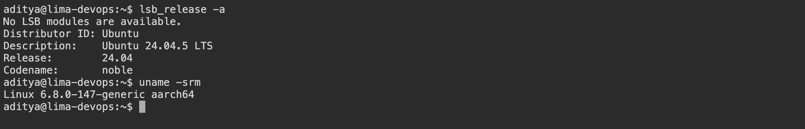

Source: [Terminal log](evidence/logs/01-ubuntu-version.txt)

### E02 - Git installation and version

`sudo apt update` followed by `sudo apt install git -y`, which upgrades the preinstalled Git package to 1:2.43.0-1ubuntu7.4. `git --version` confirms Git 2.43.0. The first lines of the apt output have scrolled off the screen; the text log has the complete output.

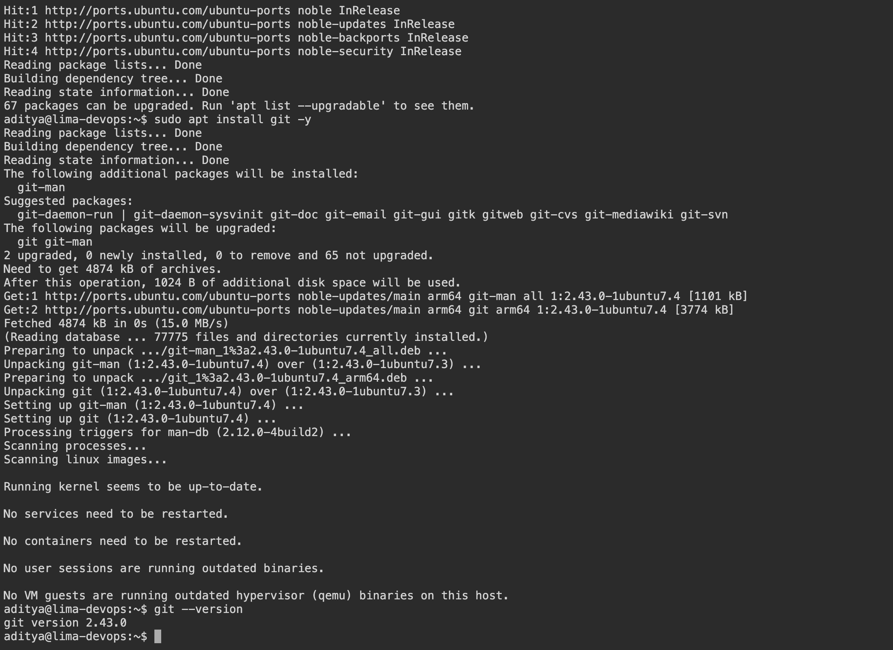

Source: [Terminal log](evidence/logs/02-git-install-and-version.txt)

### E03 - Java 21 installation and version

`sudo apt install fontconfig openjdk-21-jre python3-venv -y` installs the Java runtime required by Jenkins and the Python venv module used by the pipeline. `java -version` reports OpenJDK 21.0.13.1.

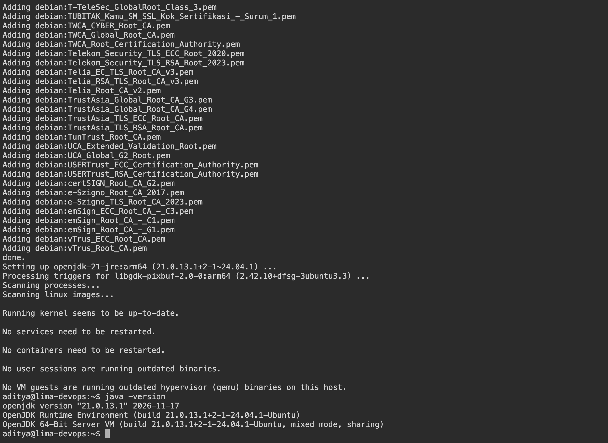

Source: [Terminal log](evidence/logs/03-java-install-and-version.txt)

### E04 - systemd is running

Process 1 is `systemd` and `systemctl is-system-running` returns `running`, so Jenkins can be managed as a systemd service.

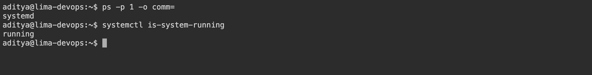

Source: [Terminal log](evidence/logs/04-systemd-running.txt)

### E05 - Jenkins apt repository

The Jenkins signing key (`jenkins.io-2026.key`) and the `debian-stable` repository are added as described in the official Jenkins Debian/Ubuntu instructions. `sudo apt update` then fetches the Jenkins package index.

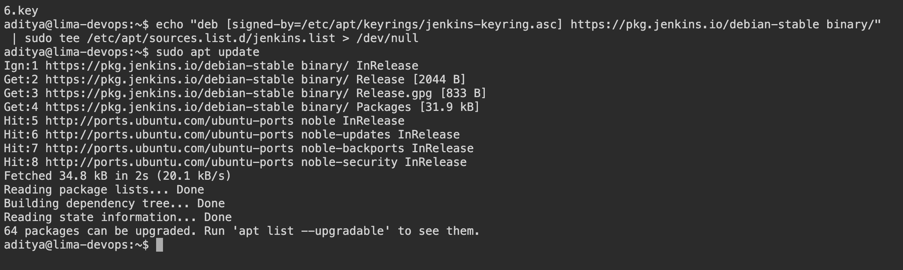

Source: [Terminal log](evidence/logs/05-jenkins-apt-repository.txt)

### E06 - Jenkins installation and version

`sudo apt install jenkins -y` installs Jenkins. `jenkins --version` reports 2.580.2 (LTS).

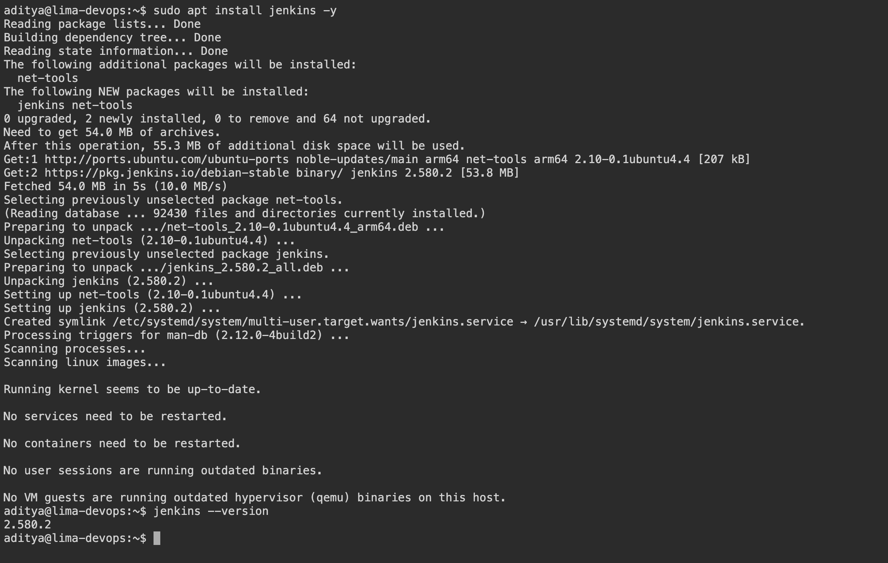

Source: [Terminal log](evidence/logs/06-jenkins-install-and-version.txt)

### E07 - Jenkins service status

`systemctl status jenkins` shows the service loaded, enabled and `active (running)`. `systemctl is-enabled` and `is-active` return `enabled` and `active`. `--lines=0` is used so that log lines containing the initial admin password are not printed.

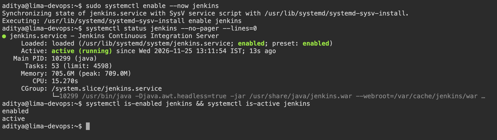

Source: [Terminal log](evidence/logs/07-jenkins-service.txt)

### E08 - Unlock Jenkins page

First visit to `http://localhost:8080`: Jenkins asks for the initial administrator password stored in `/var/lib/jenkins/secrets/initialAdminPassword`. The screenshot is taken before the password is entered; the password is not recorded anywhere in this repository.

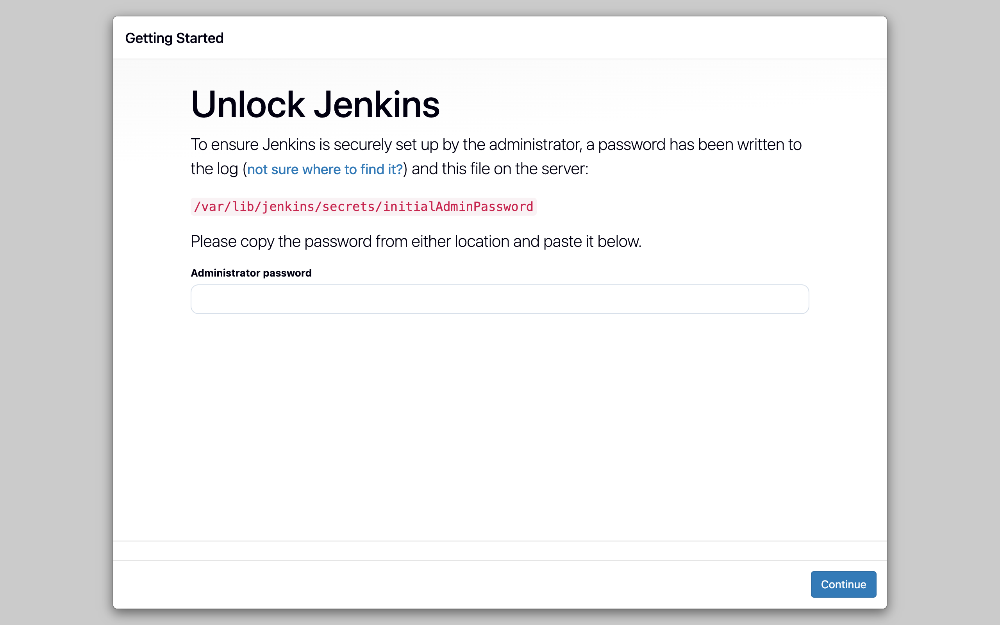

### E09 - Customize Jenkins

The setup wizard offers the plugin choice. **Install suggested plugins** was selected.

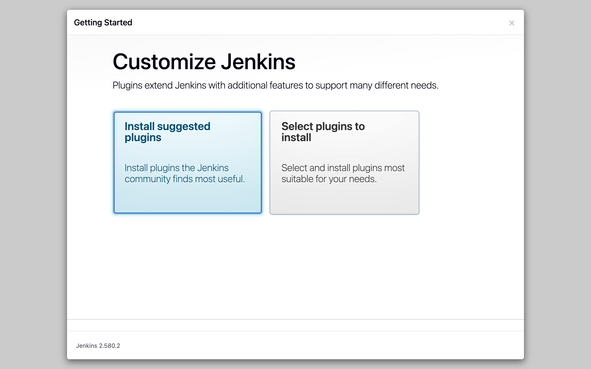

### E10 - Suggested plugins installing

Jenkins downloads and installs the suggested plugins (Git, Pipeline and others). 92 plugins were installed in total.

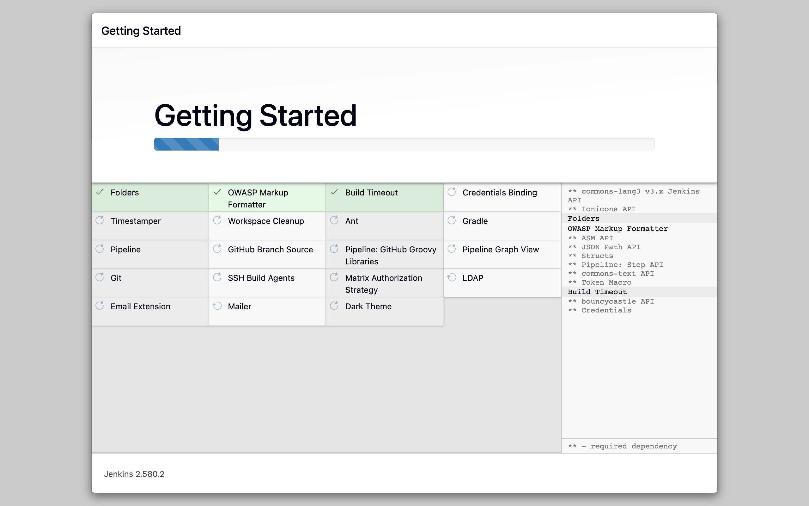

### E11 - Create first admin user

The first administrator account is created with username `aditya` and full name **Aditya Porwal**. The password fields are masked.

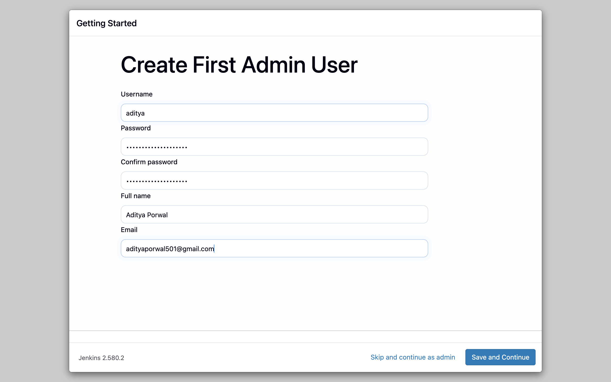

### E12 - Jenkins dashboard

After setup, the Jenkins 2.580.2 dashboard is shown for the signed-in user. No jobs exist yet.

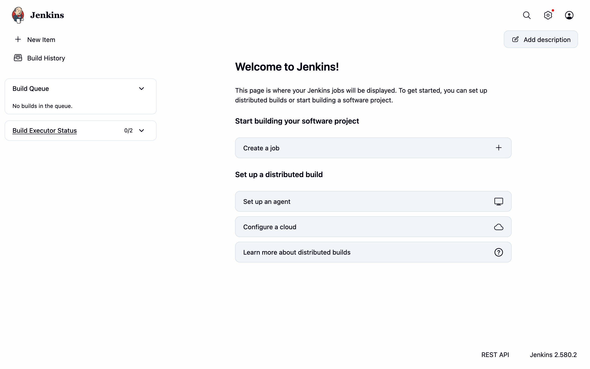

### E13 - Global Git configuration

The global Git identity is set (`user.name`, `user.email`) together with `init.defaultBranch main`. `git config --global --list` shows the three values.

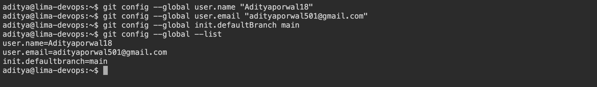

Source: [Terminal log](evidence/logs/13-git-global-config.txt)

## Q2 - Version control with Git and GitHub

The GitHub repository already existed (commit `d356070`, 13 November 2026). For this run a new local repository was initialised in the VM, connected to GitHub and synchronised, the earlier evidence files were removed, and all work below was committed on top.

### E14 - Initialise repository, add remote, pull

`git init` creates an empty repository in `~/devops-lab1`. The GitHub repository is added as `origin` and `git pull origin main` downloads the existing history. `git log` shows commit `d356070` and the working tree is clean.

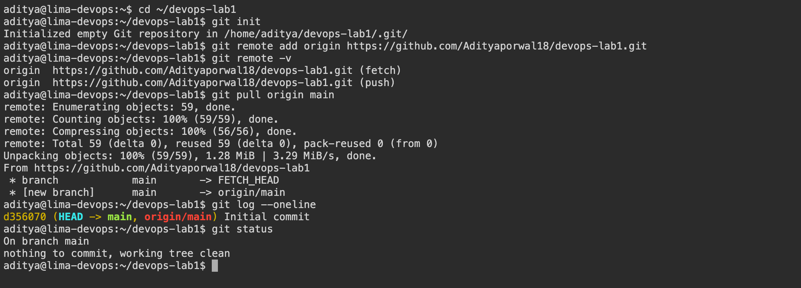

Source: [Terminal log](evidence/logs/14-git-init-remote-pull.txt)

### E15 - Remove outdated evidence (first commit of this run)

The earlier evidence and documentation files are removed with `git rm` (40 files) and committed as `f36c9b6`, so that only evidence from this run remains in the repository.

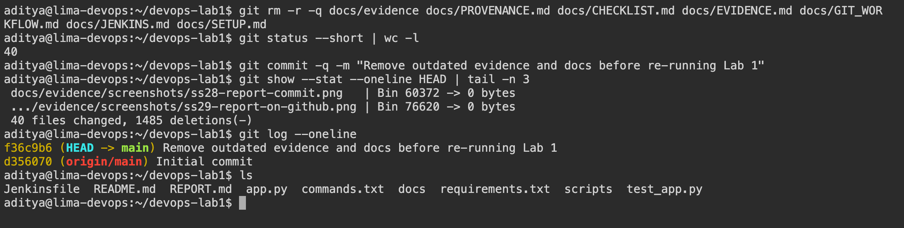

Source: [Terminal log](evidence/logs/15-remove-outdated-evidence-commit.txt)

### E16 - Feature branch and staged work

A branch `feature-subtract` is created with `git switch -c`. After editing, `git status` lists `app.py` and `test_app.py` as modified and `git diff --stat` shows 14 insertions and 1 deletion.

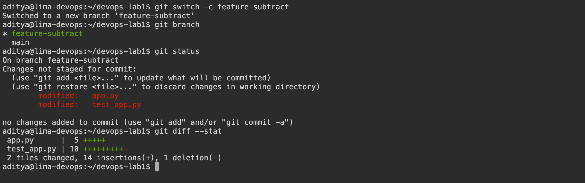

Source: [Terminal log](evidence/logs/16-feature-branch-and-changes.txt)

### E17 - Local tests pass

A virtual environment is created, `pytest` is installed from `requirements.txt` and `pytest -v` reports **4 passed**. `python3 app.py` prints `2 + 3 = 5` and `5 - 3 = 2`.

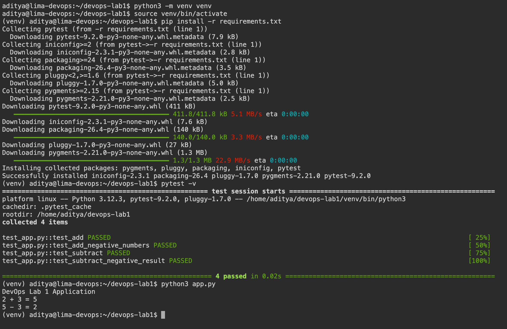

Source: [Terminal log](evidence/logs/17-local-tests-pass.txt)

### E18 - Commit on the feature branch

The two files are staged and committed as `2c565c3` ("Add subtract function with unit tests"). The graph shows `feature-subtract` one commit ahead of `main`.

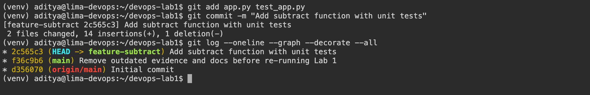

Source: [Terminal log](evidence/logs/18-feature-commit.txt)

### E19 - Merge the feature branch

`main` is checked out and `feature-subtract` is merged with `--no-ff`, creating merge commit `3a02dfc`. The graph shows the branch and the merge.

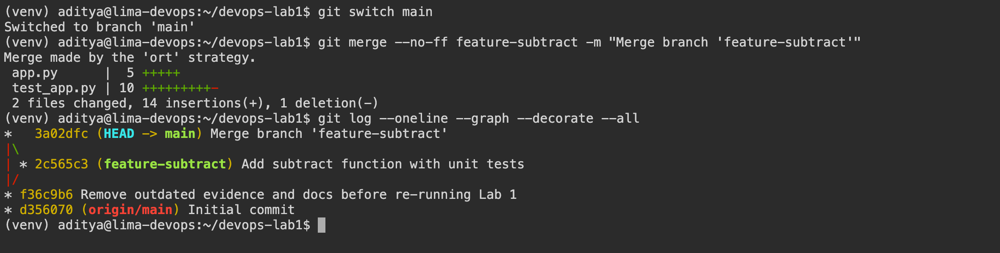

Source: [Terminal log](evidence/logs/19-merge-feature-branch.txt)

### E20 - Documentation branch, merge and history

A second branch `docs-update` carries the README rewrite (commit `2de7442`) and is merged into `main` as `0c6ed7c`. `git log --graph` shows both merges and `git branch` lists the three local branches.

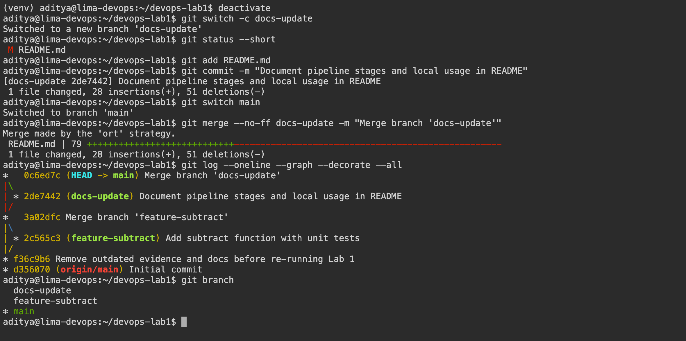

Source: [Terminal log](evidence/logs/20-docs-branch-merge-and-history.txt)

### E21 - Install GitHub CLI

`sudo apt install gh -y` installs the GitHub CLI; `gh --version` reports 2.45.0.

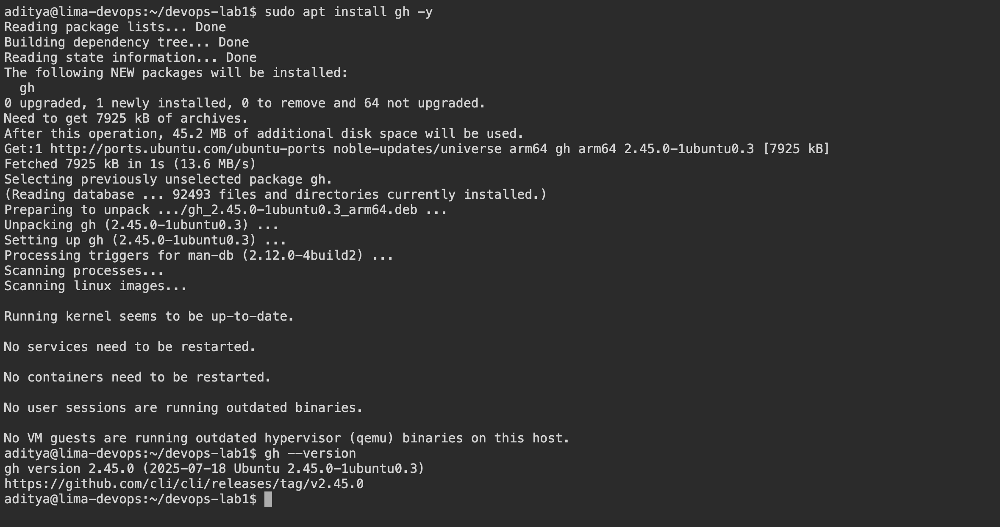

Source: [Terminal log](evidence/logs/21-install-github-cli.txt)

### E22 - GitHub authentication

`gh auth login` uses the browser device flow (the one-time code shown is single-use and has expired). The CLI reports **Logged in as Adityaporwal18** and `gh auth status` confirms the active account; the token is masked by the CLI.

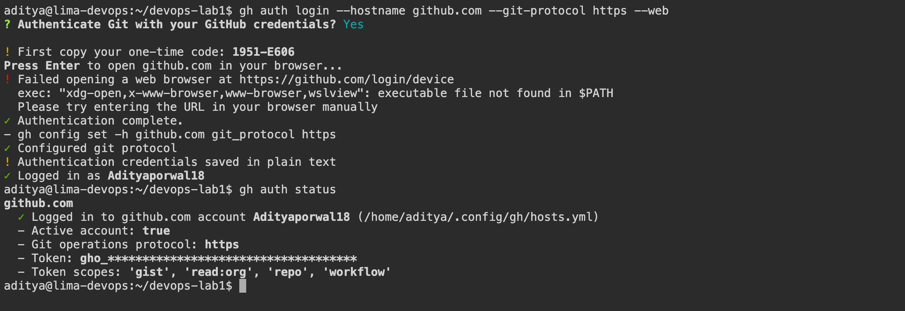

Source: [Terminal log](evidence/logs/22-github-cli-login.txt)

### E23 - Push to GitHub

`git push -u origin main` uploads the new commits (`d356070..0c6ed7c`) and sets the upstream branch. `git status -sb` shows `main` in sync with `origin/main`.

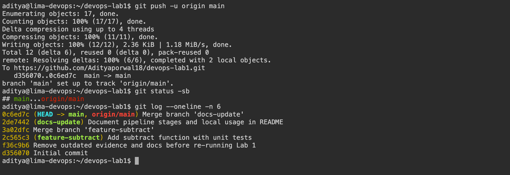

Source: [Terminal log](evidence/logs/23-git-push-to-github.txt)

### E24 - Repository on GitHub

The public repository `Adityaporwal18/devops-lab1` after the push, with the application, tests, Jenkinsfile and the rendered README.

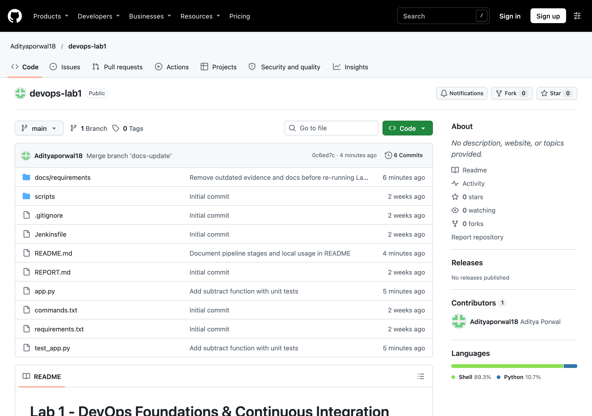

### E25 - Commit history on GitHub

GitHub lists the five commits of 25 November 2026 (removal, feature commit, merge, README commit, merge) above the earlier commit of 13 November 2026.

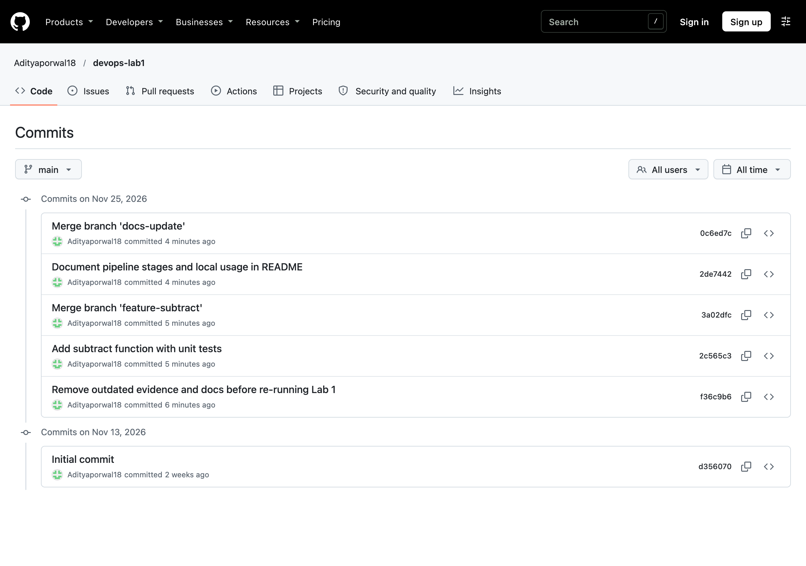

### E26 - Jenkinsfile on GitHub

The declarative `Jenkinsfile` in the repository: `pollSCM` trigger, the Build, Test and Deploy stages and the `post` actions.

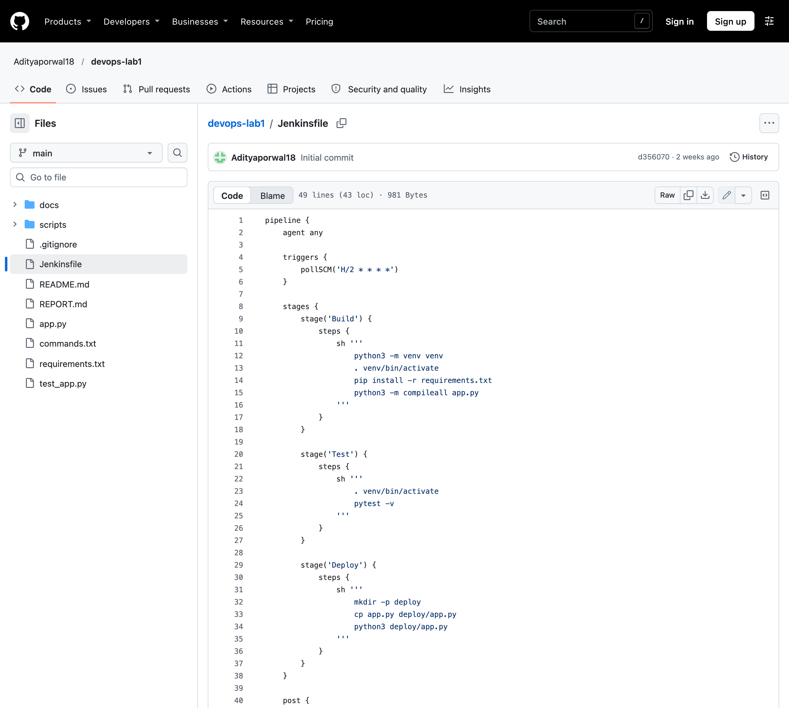

## Q3-Q5 - Jenkins pipeline, stages and automated trigger

### E27 - Pipeline job configuration

Configuration page of the job `devops-lab1` (full page): **Pipeline script from SCM**, SCM **Git**, repository URL `https://github.com/Adityaporwal18/devops-lab1.git`, branch `*/main`, script path `Jenkinsfile`. The **Poll SCM** trigger with schedule `H/2 * * * *` was registered from the Jenkinsfile by the first build. The Save/Apply bar appears in the middle because it is a floating element of the page.

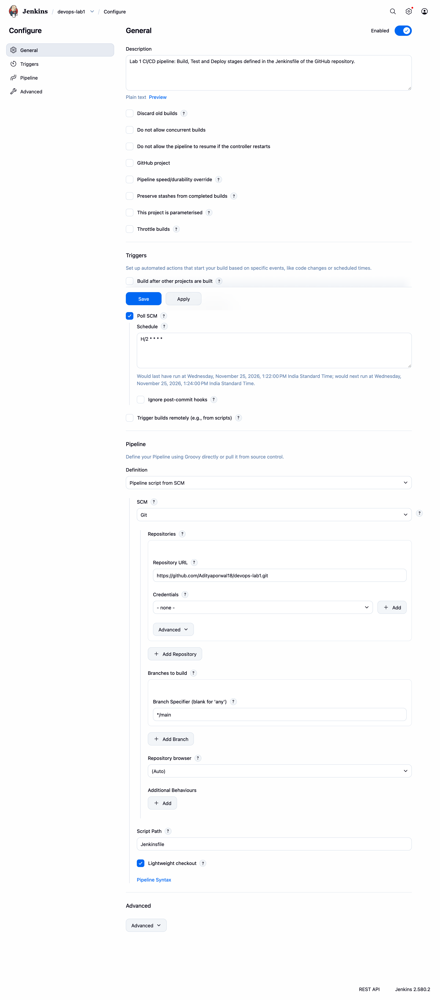

### E28 - Build #1 console - start

Build #1 is **Started by user Aditya Porwal**. Jenkins obtains the Jenkinsfile from the GitHub repository, clones it and checks out revision `0c6ed7c` ("Merge branch 'docs-update'").

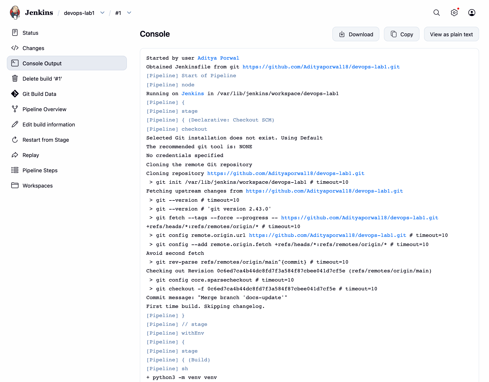

Source: [Full console log](evidence/logs/jenkins-build-1-console.txt)

### E29 - Build #1 console - tests, deploy, result

End of the same console: the Test stage reports **4 passed**, the Deploy stage copies and runs the application (`2 + 3 = 5`, `5 - 3 = 2`), the post action prints `CI/CD Pipeline completed successfully!` and the build ends with **Finished: SUCCESS**.

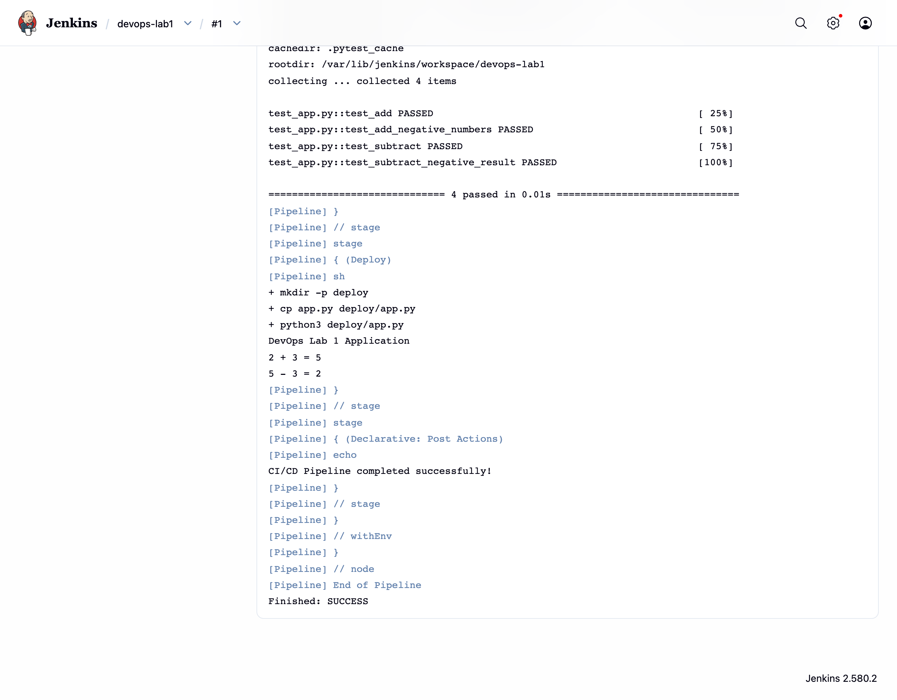

Source: [Full console log](evidence/logs/jenkins-build-1-console.txt)

### E30 - Build #1 status

Status page of build #1 (25 Nov 2026, 13:21:18): started by user Aditya Porwal, revision `0c6ed7c` from the GitHub repository, duration 14 seconds.

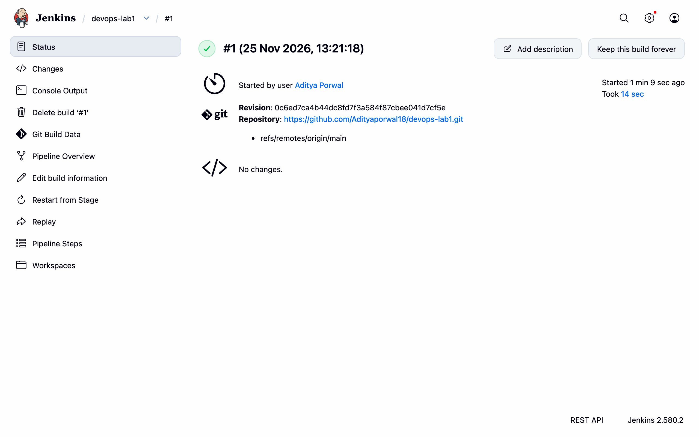

### E31 - Build #1 pipeline stages

Stage view of build #1: Checkout SCM, Build, Test, Deploy and Post Actions all succeeded. The post action output `CI/CD Pipeline completed successfully!` is shown.

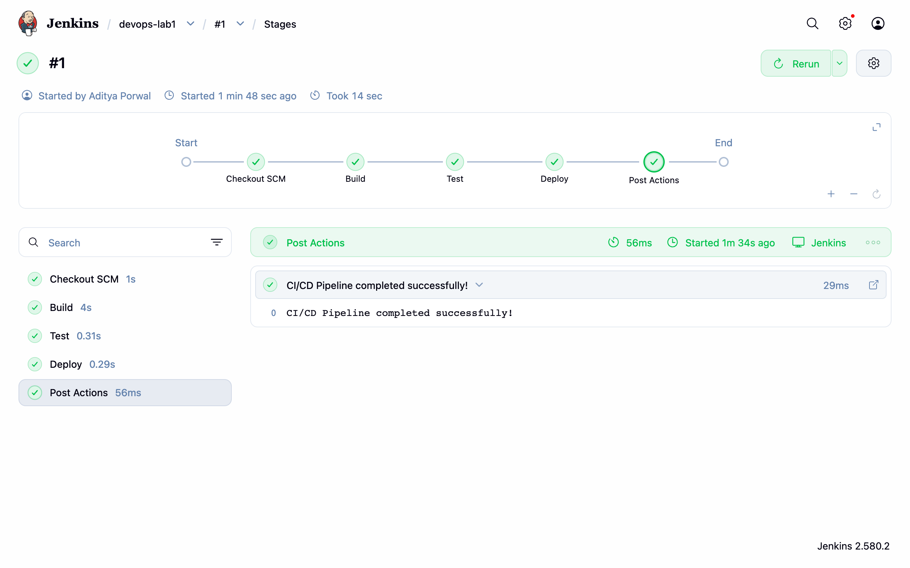

### E32 - Push a change to test the trigger

The job definition `jenkins/job-config.xml` is committed (`801426b`) and pushed to GitHub at 13:23:21 IST. No build was started manually after this push.

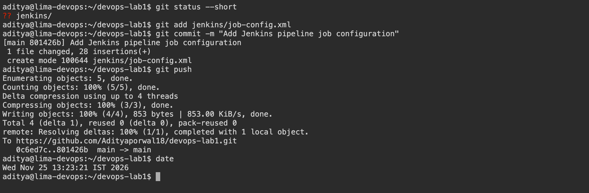

Source: [Terminal log](evidence/logs/32-push-change-for-scm-trigger.txt)

### E33 - Build #2 started by an SCM change

Build #2 begins with **Started by an SCM change**: the `pollSCM` trigger detected the new commit and started the build automatically.

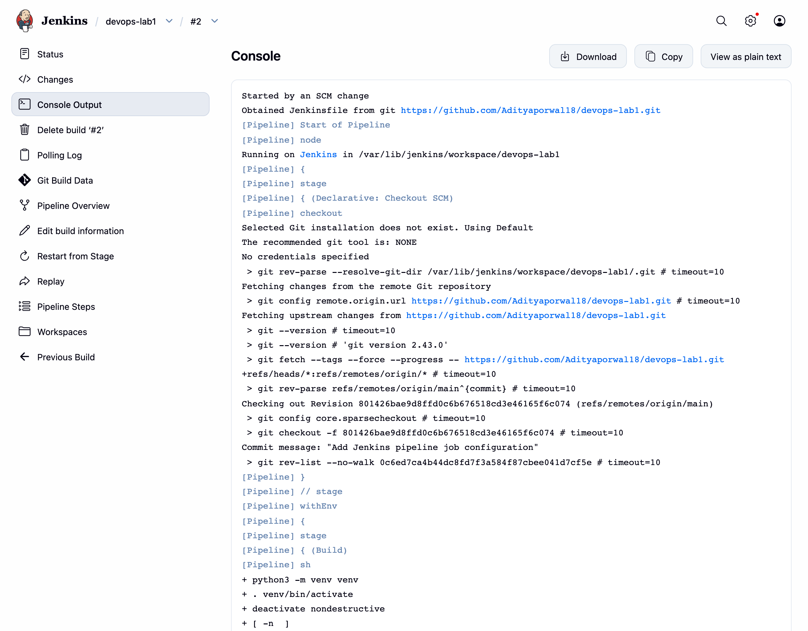

Source: [Full console log](evidence/logs/jenkins-build-2-console.txt)

### E34 - Build #2 console - result

Build #2 runs the same stages on revision `801426b`: 4 tests pass, the application is deployed and run, and the build ends with **Finished: SUCCESS**.

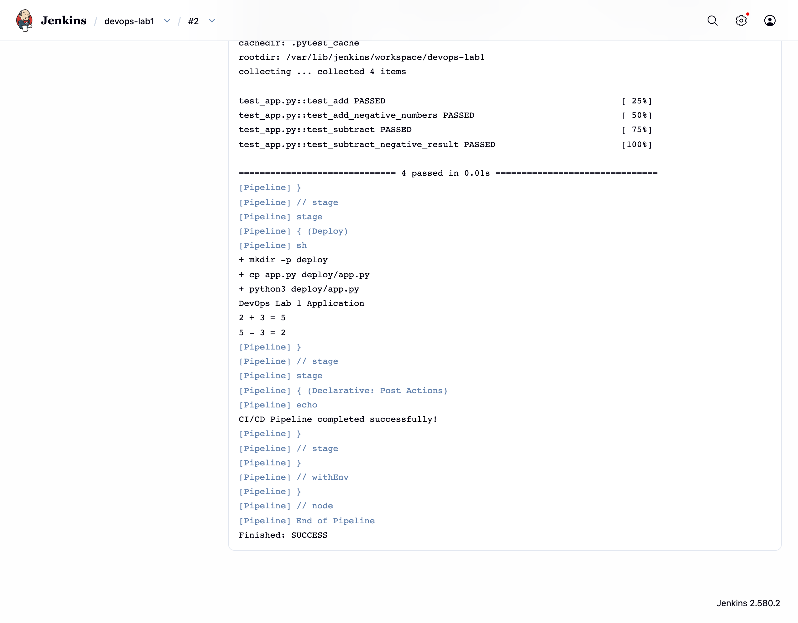

Source: [Full console log](evidence/logs/jenkins-build-2-console.txt)

### E35 - Git polling log

The Git polling log of the job: polling started at 1:24:00 PM, compared the last built revision `0c6ed7c` with the remote head `801426b` and reported **Changes found**.

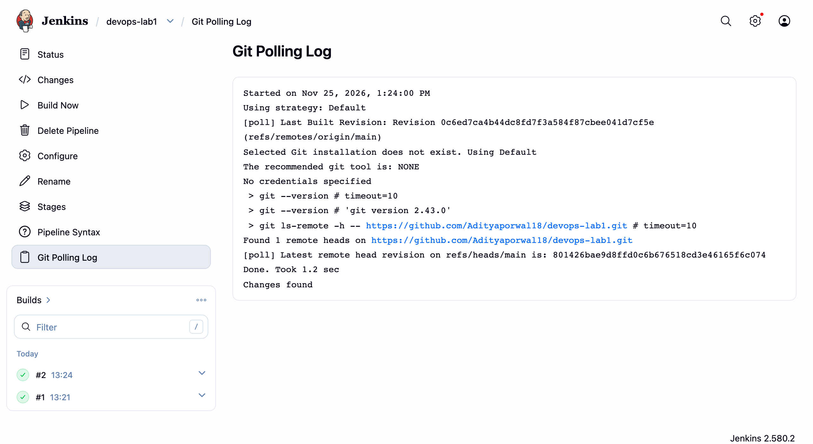

Source: [Polling log text](evidence/logs/jenkins-scm-polling-log.txt)

### E36 - Build history

Job page of `devops-lab1`: builds #1 (13:21) and #2 (13:24) are both successful.

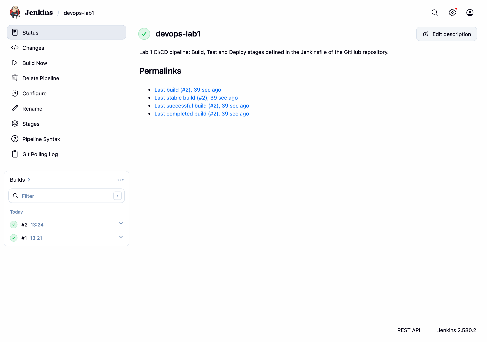
